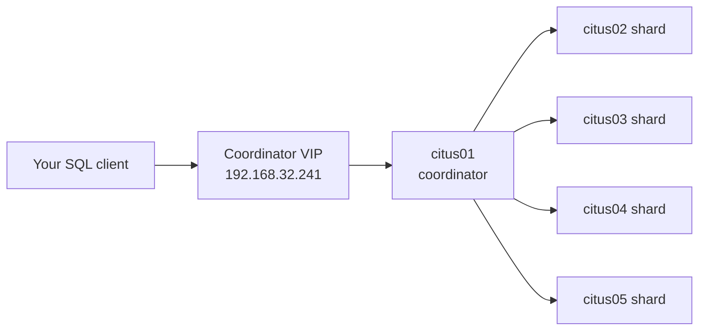

# PostgreSQL sharding with Citus

This lab is one PostgreSQL database spread across five machines, with a standby for each machine. You run ordinary SQL against the coordinator. Citus stores each row on one of the five primaries. Patroni, etcd, HAProxy, and Keepalived keep that shard available when its primary is down for maintenance.

The virtual machines run AlmaLinux 9 on VirtualBox. PostgreSQL is 19rc2. Citus is 15.0devel, built from source because the Citus 14.3 packages stop at PostgreSQL 18.

First-time install, download links, and the build order are in [INSTALL.md](INSTALL.md).

## The idea in one picture

A distributed table is cut into shards. This lab uses five shards, so each primary holds one shard. The standby is a full streaming copy of that primary. It is the machine that takes over during a maintenance window.

```text
  customers (1,000 rows)
        |
        |  hash(customer_id)  -->  5 shards, one copy of each shard
        |
   +---------+---------+---------+---------+---------+
   | shard A | shard B | shard C | shard D | shard E |
   | citus01 | citus02 | citus03 | citus04 | citus05 |
   +----+----+----+----+----+----+----+----+----+----+
        |         |         |         |         |
     citus01b  citus02b  citus03b  citus04b  citus05b
     standby   standby   standby   standby   standby
```

`orders` uses the same `customer_id` hash, so a customer's orders sit on the same machine as that customer. A join on `customer_id` runs locally on each node. `countries` is a reference table: the same five rows exist on every node, so every shard can look up a country without calling another machine.

## How a query travels



1. You connect to `192.168.32.241`. Keepalived holds that address on whichever node is the coordinator primary.
2. HAProxy on that address accepts the session only when Patroni says the node is the primary.
3. The coordinator looks at `pg_dist_node`, sends each shard's part of the query to the worker that holds it, and returns one result.

The coordinator also holds a shard. It is group 0, and `shouldhaveshards` is on.

## One group, and what maintenance does

Each pair is one Patroni group and one Citus group. The group has one primary. The standby follows it with streaming replication.

```text
group 4
  citus05   primary   192.168.32.167   virtual IP 192.168.32.245
  citus05b  standby   192.168.32.145
```

Before `citus05` reboots, `./pg_lab` moves the group to `citus05b`:

```text
group 4 during maintenance
  citus05b  primary   virtual IP 192.168.32.245 still answers
  citus05   standby   safe to reboot
```

Patroni updates `pg_dist_node` so the coordinator sends group 4's shard to `citus05b`. The other four groups keep their own primaries. When the work is done:

```bash
./pg_lab switchover --yes --node citus05b
```

If the primary disappears without that planned move, Patroni promotes the standby after the leader lock expires, about 40 seconds.

`./pg_lab restart-db --yes --node citus05` restarts PostgreSQL on `citus05` and leaves `citus05` as the primary. Patroni stays up during that restart and keeps the leader lock.

## The five pieces

| Piece | Where it runs | What it does |
| --- | --- | --- |
| Citus | Every database | Splits tables, routes SQL, records which host owns each group |
| Patroni | All 10 VMs | Starts PostgreSQL, chooses the primary, updates Citus on a role change |
| etcd | citus01, citus02, citus03 | Stores the leader decision. Two of these three must be up |
| HAProxy | All 10 VMs | Forwards port 5432 only to the node whose Patroni check says `/primary` |
| Keepalived | All 10 VMs | Moves the group's virtual IP onto the current primary |

Citus and replication use the real hostnames (`citus05`, `citus05b`). The virtual IP is only the address clients use. Standbys are tagged `noloadbalance`, so they stay out of `pg_dist_node` until one of them becomes the primary.

```text
clients
   |
   |  192.168.32.241 ... 245
   v
Keepalived  -- holds the virtual IP on the current primary
   |
HAProxy     -- checks Patroni GET /primary, then forwards to that host:5432
   |
Patroni     -- primary or standby, recorded in etcd
   |
PostgreSQL + Citus
```

## Machines

| Group | Primary | Standby | Virtual IP | Mac port for the primary |
| --- | --- | --- | --- | --- |
| 0 coordinator | citus01 `.163` | citus01b `.141` | `192.168.32.241` | 15432 |
| 1 | citus02 `.164` | citus02b `.142` | `192.168.32.242` | 15433 |
| 2 | citus03 `.165` | citus03b `.143` | `192.168.32.243` | 15434 |
| 3 | citus04 `.166` | citus04b `.144` | `192.168.32.244` | 15435 |
| 4 | citus05 `.167` | citus05b `.145` | `192.168.32.245` | 15436 |

Standby ports on this Mac are `15442` through `15446`. Primaries ask for 2560 MB and 2 CPUs. Standbys ask for 2048 MB and 1 CPU. A VM that was suspended keeps its old memory until a clean power-off.

Database `postgres`. Superuser password `Postgres@123`. Replication user `replicator`, password `Replicator@123`. These are lab passwords.

Leave the old powered-off VM `Citus_citus01` off while this lab runs. It uses the same address as `citus01`, `192.168.32.163`.

## Bring the lab up

A new machine follows [INSTALL.md](INSTALL.md): install VirtualBox and Vagrant, clone this repository, then `vagrant up`. After the lab already exists, start it from this directory:

```bash
./pg_lab start
./pg_lab health
./pg_lab ha
./pg_lab psql -c 'SELECT count(*) FROM customers;'
```

`./pg_lab start` boots every virtual machine first, then waits for PostgreSQL. Patroni waits until etcd has two of `citus01`, `citus02`, and `citus03`.

Connect from the Mac:

```bash
psql -h 192.168.32.241 -p 5432 -U postgres
psql -h 127.0.0.1 -p 15432 -U postgres
```

A fresh clone also needs the first build. `vagrant up` installs PostgreSQL and Citus. After the five primaries are running, create the tables once:

```bash
cat vagrant-configs/citus-cluster.sh | vagrant ssh citus01 -c 'sudo bash -s'
./pg_lab ha-init --yes
```

`ha-init` adopts the existing data directories, clones the five standbys, and checks a switchover. It has already been run on the lab that produced this repository. Running it again repeats that adoption.

Practice queries for shards, inserts, and joins are in [ARCHITECTURE.md](ARCHITECTURE.md).

## Flags used by pg_lab

| Flag | Effect |
| --- | --- |
| `--yes` | Skip the confirmation question |
| `--node citus05` | Limit the command to that machine. Names are `citus01`–`citus05` and `citus01b`–`citus05b` |
| `--dry-run` | Print the plan and change nothing |
| `--no-reboot` | `os-patch` installs packages and leaves the reboot for later |

Commands that walk several machines go in this order: `citus05`, `citus04`, `citus03`, `citus02`, then `citus01`. Workers move first. The coordinator moves last.

## Every pg_lab command

### help

```bash
./pg_lab help
```

Prints the command list from the top of the script.

### status

```bash
./pg_lab status
```

One row per machine. Columns are the VirtualBox state, AlmaLinux version, kernel, whether Patroni or PostgreSQL is the running service, the PostgreSQL version, the Citus version, the server RPM, and free disk. A machine that is off still gets a row.

### health

```bash
./pg_lab health
```

Asks the coordinator for the five `pg_dist_node` primaries, the server and Citus versions, and the row counts of `countries`, `customers`, and `orders`. The command fails when the number of active primaries is anything other than 5. A healthy lab shows 5 countries, 1,000 customers, and 5,000 orders.

### precheck

```bash
./pg_lab precheck
./pg_lab precheck --node citus01
```

Checks that each target is running, that Patroni or PostgreSQL answers, and that the disk has at least 1 GB free. A primary row in `pg_dist_node` shows `active`. A standby shows `standby`. `reboot`, `os-patch`, `db-patch`, and `restart-db` run this check before they change anything.

### start

```bash
./pg_lab start
./pg_lab start --node citus03
```

Powers on the machines with `vagrant up --no-provision`, then waits until PostgreSQL accepts connections. The full start brings all ten machines up before that wait, because etcd needs a quorum. After a full start it resumes Patroni groups that were left paused.

### stop

```bash
./pg_lab stop --yes --node citus05
./pg_lab stop --yes
```

`--node` moves that group's leadership to the standby, then halts the machine. The shard stays available on the partner.

A stop of every machine pauses Patroni first, so the halt does not turn into a promotion race, then halts standbys and primaries.

### reboot

```bash
./pg_lab reboot --yes --node citus05
./pg_lab reboot --dry-run
```

For each target, moves leadership to the standby when that node is the primary, reboots the VM, waits for PostgreSQL, and checks that the coordinator can still read `customers`. A full reboot walks workers first and the coordinator last.

### os-patch

```bash
./pg_lab os-patch --yes
./pg_lab os-patch --yes --node citus04
./pg_lab os-patch --yes --no-reboot
```

Updates AlmaLinux packages on the target. The `postgresql19` packages stay as they are. When AlmaLinux asks for a reboot, the command reboots that node through the same leadership move as `reboot`. `--no-reboot` installs the packages and prints that a reboot is still required.

### db-patch

```bash
./pg_lab db-patch --yes
./pg_lab db-patch --yes --node citus03
```

Runs `dnf update` for `postgresql19` packages only. When an RPM changes, the node rebuilds Citus from the pinned source and restarts PostgreSQL through Patroni. When the packages are already current, the node stays up and the result is `UNCHANGED`.

### restart-db

```bash
./pg_lab restart-db --yes --node citus02
```

Restarts PostgreSQL on that member through `patronictl restart`. The same node remains the primary. Use `reboot` or `maint` when the standby should take the shard.

### backup

```bash
./pg_lab backup
./pg_lab backup /tmp/pgcitus-backups
```

Runs `pg_dump` of database `postgres` on the coordinator and writes `postgres-YYYYMMDD-HHMMSS.sql`. The default directory is `backups/`. The dump holds table definitions and rows. Citus distribution commands are applied again by `restore`.

### backups

```bash
./pg_lab backups
./pg_lab backups /tmp/pgcitus-backups
```

Lists dump files in that directory with size and modification time.

### restore

```bash
./pg_lab restore --yes backups/postgres-YYYYMMDD-HHMMSS.sql
```

Drops `orders`, `customers`, and `countries`, loads the dump, then distributes them again: `countries` as a reference table, `customers` on `customer_id`, and `orders` colocated with `customers`. Foreign keys are put back after the distribution. This replaces the live tables.

### shards

```bash
./pg_lab shards
```

Shows how many shards of each table sit on each node, then the customer row count on each node. The five customer counts add up to 1,000.

### activity

```bash
./pg_lab activity
```

Shows session counts by state on the coordinator, then the active queries besides the one running this command.

### ha

```bash
./pg_lab ha
```

Two tables. The first is every node's Patroni group, role (`primary` or `replica`), and state. The second is each virtual IP and the PostgreSQL server address answering behind it. On a quiet lab the virtual IPs point at `192.168.32.163` through `.167`.

### ha-init

```bash
./pg_lab ha-init --yes
```

One-time setup. It installs Patroni, etcd, HAProxy, and Keepalived, adopts the existing data directories, clones each standby, and proves a switchover plus a failover of `citus05`. Use it once on a new cluster.

### switchover

```bash
./pg_lab switchover --yes --node citus05
```

Requires `--node`. If that node is the Patroni leader and its partner is streaming, leadership moves to the partner. Citus follows the new primary. The command then checks `customers`. If the node is already the standby, it stays there.

Move group 4 back after maintenance with the node that is the leader:

```bash
./pg_lab switchover --yes --node citus05b
```

### maint

```bash
./pg_lab maint --yes --node citus05
```

The maintenance form of `switchover`. It moves the group to the standby and prints that the named node is now the standby. The partner serves the shard until you switch back.

### logs

```bash
./pg_lab logs
./pg_lab logs --node citus02
./pg_lab logs --node citus02 200
```

Prints the Patroni journal for that machine. The default node is `citus01` and the default length is 80 lines. A machine that has no Patroni unit shows the `postgresql-19` journal instead.

### psql

```bash
./pg_lab psql
./pg_lab psql -c 'SELECT count(*) FROM customers;'
```

Opens `psql` on the coordinator as `postgres`, or runs one SQL statement. After a coordinator switchover this follows `citus01` or `citus01b`, whichever Patroni currently calls the primary.

## What each directory holds

| Path | Role |
| --- | --- |
| `INSTALL.md` | Downloads and the first-time setup |
| `Vagrantfile` | Ten VMs, addresses, and host ports |
| `pg_lab` | The command wrapper on the Mac |
| `vagrant-configs/citus-cluster.sh` | Creates `countries`, `customers`, and `orders` |
| `vagrant-configs/citus-pg19-install.sh` | Installs PostgreSQL 19rc2 and builds Citus |
| `vagrant-configs/ha/` | Patroni, etcd, HAProxy, and Keepalived |
| `vagrant-configs/ops/` | Guest scripts for facts, precheck, and patches |
| `backups/` | `pg_dump` files used by `restore` |
| `ARCHITECTURE.md` | SQL practice against the live tables |
